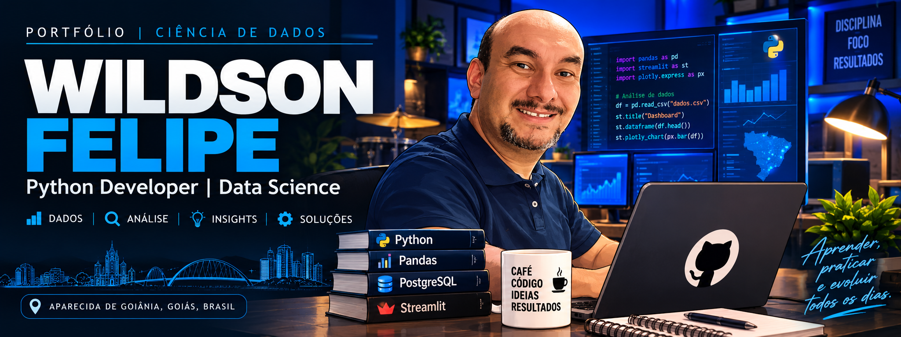

  

 

# 👋 Olá, eu sou Wildson Felipe!

### 🎓 Estudante de Ciência de Dados | 🐍 Python | 📊 Análise de Dados

**Transformando dados em conhecimento e conhecimento em soluções.**

---

## 👨‍💻 Sobre mim

🎓 Cursando **Técnico em Ciência de Dados** na Escola do Futuro do Estado de Goiás — Luiz Rassi.

💻 Desenvolvendo habilidades em Python, SQL, análise de dados e desenvolvimento de aplicações.

📊 Interesse em ETL, visualização de dados, APIs e Business Intelligence.

🚀 Buscando evoluir profissionalmente na área de tecnologia e Ciência de Dados.

📍 Goiás, Brasil.

---

## 🛠️ Tecnologias e ferramentas

---

## 🚀 Projetos em destaque

### 🌎 [Sismo 360° — Monitoramento Global de Terremotos](https://github.com/wildsonfelipe/Projeto_Sismo360)

Projeto de Ciência de Dados com Python, API USGS, Pandas, SQLite, Streamlit e Plotly. Inclui consultas sísmicas históricas, filtros por período e magnitude, mapa mundial interativo, indicadores, gráficos e exportação CSV.

📄 [Visualizar Dashboard em PDF](https://github.com/wildsonfelipe/Projeto_Sismo360/blob/main/Dashboard_Visualiza%C3%A7%C3%A3o.pdf)

### 💱 [Câmbio 360°](https://github.com/wildsonfelipe/Projeto_cambio360)
Aplicação para consulta e análise de taxas de câmbio utilizando Python, APIs e Streamlit.

### 📈 [Projeto_Coinbase — Análise de Criptomoedas](https://github.com/wildsonfelipe/Projeto_coinbase)
Projeto de ETL que consome dados da API Coinbase, realiza tratamento com Python e Pandas e apresenta visualizações em Streamlit.

### 📊 SISDEPEN Goiás
Projeto de ETL e análise de dados sobre escolaridade da população privada de liberdade no estado de Goiás.

### 🗄️ Banco de Dados
Projetos de modelagem conceitual, lógica e física utilizando PostgreSQL.

---

## 📈 Minha atividade no GitHub

---

### 💡 "Aprender, praticar e evoluir todos os dias."

Obrigado pela visita! 🚀

